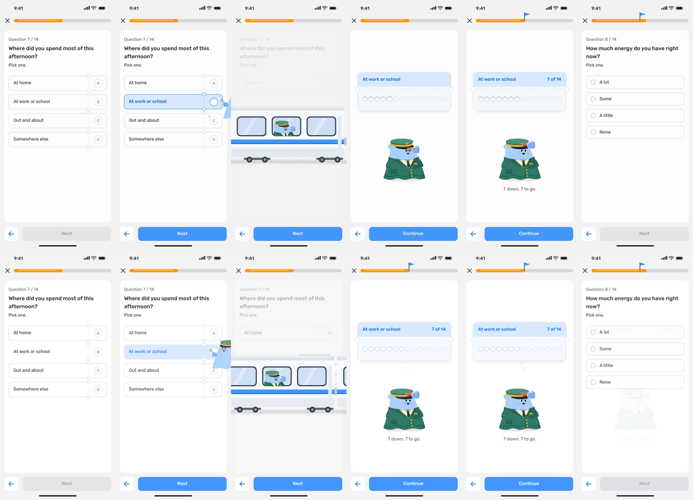
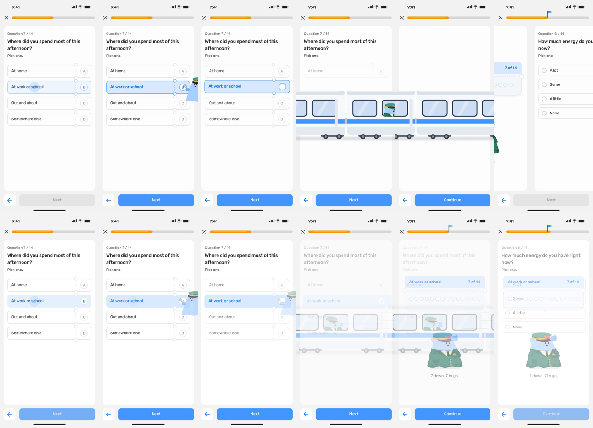

# Authoring proof: moments made without Figma Motion

Four moments, made 22 Oct 2026 through the three new routes, each ending in a validated, linted alive/1 scene and a
preview MP4 drawn by the runtime (`alive preview`: `flutter test` runs the runtime, ffmpeg encodes). Everything below
can be made again with the commands at the end.

| Route | Moment | Input | Passes | validate | lint (art + motion rules) | Preview |
|---|---|---|---|---|---|---|
| Prompt (skill, no key) | `diary-done` | "Fabio cheers when the diary is finished, confetti, then settles" | 3 | ok | 0 errors, 0 warnings | [diary-done.mp4](../examples/moments/out/diary-done.mp4), 2.9 s |
| Prompt (skill, no key) | `letter-ready` | "A new diary is ready: Fabio pops up with the envelope, shows it to you, then waits for your tap" | 3 | ok | 0 errors, 0 warnings | [letter-ready.mp4](../examples/moments/out/letter-ready.mp4), 3.8 s |
| Sketch (skill, no key) | `storage-heads-up-sketch` | 4 frames of the board video 06-storage-heads-up.mp4 | 3 | ok | 0 errors, 0 warnings | [side by side](../examples/sketch/out/storage-heads-up-sketch.side-by-side.mp4), 3.8 s |
| Storyboard | `halfway-express-story` | 7 Figma frames of section Halfway Express | 1 (measured) | ok | 0 errors, 0 warnings | [result](../examples/storyboard/out/halfway-express-story.mp4), [beside the approved film](../examples/storyboard/out/halfway-express-story.vs-figma.mp4), 7.1 s |

The API routes (`alive prompt`, `alive sketch` without `--beats`) were not run against the API: there is no
ANTHROPIC_API_KEY on the test machine and none was asked for. They are tested against a stand-in server
(`tools/test/author.test.mjs`): a first reply with an unknown face goes back to the model as a problem, the second
reply passes, the scene is written. Not measured: how well a model does through that route.

## Prompt route: the alive-author skill

Claude (in Claude Code, no API key) followed `.claude/skills/alive-author/SKILL.md`: the cause, his home and the one
focal point first; the catalog and the rules; a moment file; `alive moment ... --preview --draft`; then it read the
contact sheet and changed what broke the review checklist. Each pass is kept: its moment file and its sheet.

### diary-done

Prompt: "Fabio cheers when the diary is finished, confetti, then settles". Moment file:
[examples/moments/diary-done.moment.json](../examples/moments/diary-done.moment.json).

| Pass | What the stills showed | What changed |
|---|---|---|
| [1](../examples/moments/passes/diary-done/pass1.sheet.png) | the headset look reads as the recording desk; both raised paws float wide of him at head height; the pill sits 110 units above his head (two far-apart focal points) | coach look; paws in closer; pill nearer |
| [2](../examples/moments/passes/diary-done/pass2.sheet.png) | his cap hits the pill at the top of the jump; confetti flies over the pill; the coach jacket is bulky at this size | pen-pal look; a lower jump; pill higher; confetti from his shoulders, behind him |
| [3](../examples/moments/passes/diary-done/pass3.sheet.png) | pill first, then his cheer, confetti under the pill, a held happy end | final render |


### letter-ready

Prompt: "A new diary is ready: Fabio pops up with the envelope, shows it to you, then waits for your tap". Moment:
[examples/moments/letter-ready.moment.json](../examples/moments/letter-ready.moment.json).

| Pass | What the stills showed | What changed |
|---|---|---|
| [1](../examples/moments/passes/letter-ready/pass1.sheet.png) | he fades in while sliding up from nowhere; cheeks on from the first frame | a pop in place (scale with an overshoot); neutral face until he shows the envelope; a cropped, zoomed review of the paw |
| [2](../examples/moments/passes/letter-ready/pass2.sheet.png) | the M3 rule holds (hold paw over the envelope's corner, then the present paw under it), but the kit's `tilt` brings its own puzzled face: waiting reads as confusion | a beat's face now wins over a kit action's (compiler); he stays happy through the tilt |
| [3](../examples/moments/passes/letter-ready/pass3.sheet.png) | pop, hold, present, a pause, a friendly tilt, a held end | final render |


After the passes, the compiler's tests found that a property keyed for the first time on a beat eased from the start
of the clip instead of holding until its move began; fixed, and both finals were rendered again with the fix (the
pass sheets are as they were).

## Sketch route: four frames of a board video

Rough material: four frames of the approved board video `<boards>/show/videos/06-storage-heads-up.mp4` at 0.40,
0.80, 1.50 and 2.90 s (real frames, not drawn sketches), in `examples/sketch/heads-up/`. Claude read them as beats
through the skill route: the doorman look, facing left, standing on the Record button's top edge at the right, the
parcel held in front, worried when the low storage card pops at his upper left, the card dimming on Make room, then
sinking back. Moment: [examples/sketch/heads-up/heads-up.moment.json](../examples/sketch/heads-up/heads-up.moment.json).

| Pass | What the side by side showed | What changed |
|---|---|---|
| [1](../examples/sketch/passes/pass1.sheet.png) | at 0.40 s his whole head shows where the frame shows only his cap; his far paw is cut by the frame's right edge | lower at 0.40 s; feet further in; far paw tucked; parcel nearer his middle |
| [2](../examples/sketch/passes/pass2.sheet.png) | his coat shows below the button: in the app the area under the button hides him | that area as a white panel drawn in front of him, before the button |
| [3](../examples/sketch/passes/pass3.sheet.png) | cap only at 0.40 s, standing with the parcel at 0.80 s, worried beside the card at 1.50 s, card dimmed at 2.90 s | final render |

Each input image beside the runtime's frame at its beat (left: the board video frame; right: the moment):


Two differences remain, both the kit's: he carries the parcel with one paw (the kit has no far paw that comes in
front for a two-handed carry; the frames show two), and the card is a stand-in shape without its buttons (the app
draws the real card).

## Storyboard route: the Halfway Express

The storyboard: the seven per-moment frames of section Halfway Express in the design file, page "Old:
Encouragement" (Q7, Pick, Punch, Lift, Train, Halfway, Q8), read only with `tools/figma/read-storyboard.figma.js`
(four `use_figma` calls) and exported as SVG with `download_assets` (seven calls), saved in
`tools/figma/cache/storyboards/halfway-express/`. 277 layers matched by name; 71 move or fade; 220 appear in a later
frame (the train, the halfway ticket, Q8's options) and are drawn from that frame's export.

Timing: the frames have no timing in their names, and the file is read only here, so the timing file
[examples/storyboard/halfway-express.timing.json](../examples/storyboard/halfway-express.timing.json) carries it, as
the designer would type it in the names, following the beats of the approved film (pick 0.78 to 0.95 s, punch 1.0 to
1.9, lift 1.75 to 2.45, train 2.3 to 3.6, halfway 3.0 to 4.55, slide to Q8 5.95 to 6.6, end 7.1).

Compared with the approved film, Figma's MP4 export of the Express frame
(`<boards>/motion/encouragement/halfway-express.mp4`), with the metric of docs/figma-proof.md (the share of
pixels whose largest channel difference is over 40 of 255), drawn by the runtime (`test/figma_proof_test.dart`):

| Instants | Storyboard, eased (average / worst) | Same frames, cut at each beat (average / worst) |
|---|---|---|
| the six figma-proof instants (0.6, 1.77, 2.97, 4.13, 5.33, 6.5 s) | **1.5% / 4.7%** | 1.4% / 4.7% |
| each frame's arrival (7) | 2.0% / 5.4% | not measured |
| mid-transition (0.87, 1.2, 1.87, 2.6, 3.3, 6.27 s) | 5.6% / 10.9% | 4.6% / 12.0% |

For scale, from docs/figma-proof.md at the same six instants: `alive figma` on the keyframed Express frame itself
0.4% (worst 0.5%); the older procedural import 1.5%.

What the numbers say. At the six instants the storyboard is within 1.5% of the film on average: those instants fall
where the film rests on poses the frames show. Its worst instant (4.7% at 2.97 s) is the train mid-pass: the film
moves the train across the screen, the storyboard fades it in where the Train frame has it. Between frames the
eased storyboard is not better than plain cuts on average (5.6% against 4.6%): Smart Animate cross-fades where the
film slides a page (the slide to Q8 at 6.27 s: 10.9% eased, 2.6% cut, because the cut has already switched to Q8),
and it is better where the film fades a page in (the halfway page at 3.3 s: 8.5% eased, 12.0% cut). A storyboard
gives poses, not paths; for slides and passes, add a frame for the in-between pose or key that part in Figma Motion.

Top row the approved film, bottom row the storyboard scene, at the six instants:



The same at mid-transition:



Every number per instant: [authoring-proof/storyboard-measured.json](authoring-proof/storyboard-measured.json).

## Making them again

```bash
node tools/alive.mjs moment examples/moments/diary-done.moment.json --out examples/moments/out/diary-done --preview examples/moments/out/diary-done.mp4
node tools/alive.mjs moment examples/moments/letter-ready.moment.json --out examples/moments/out/letter-ready --preview examples/moments/out/letter-ready.mp4
node tools/alive.mjs sketch examples/sketch/heads-up/frame-0.40s.png examples/sketch/heads-up/frame-0.80s.png \
  examples/sketch/heads-up/frame-1.50s.png examples/sketch/heads-up/frame-2.90s.png \
  --beats examples/sketch/heads-up/heads-up.moment.json --out examples/sketch/out/storage-heads-up-sketch --preview examples/sketch/out/storage-heads-up-sketch.mp4
node tools/alive.mjs storyboard halfway-express --id halfway-express-story --out examples/storyboard/out/halfway-express-story \
  --timing examples/storyboard/halfway-express.timing.json --preview examples/storyboard/out/halfway-express-story.mp4
# the measurement
node tools/figma-proof.mjs plan --manifest examples/storyboard/out/manifest.json --work /tmp/sb   # add --at 865,1200,... for other instants
ALIVE_FIGMA_PROOF=/tmp/sb flutter test test/figma_proof_test.dart
node tools/figma-proof.mjs report --work /tmp/sb
```
